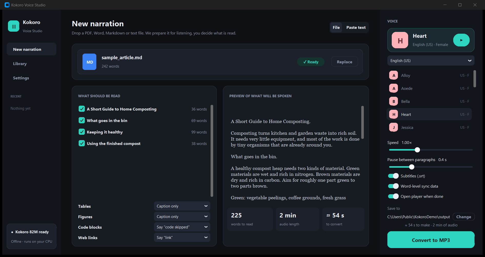
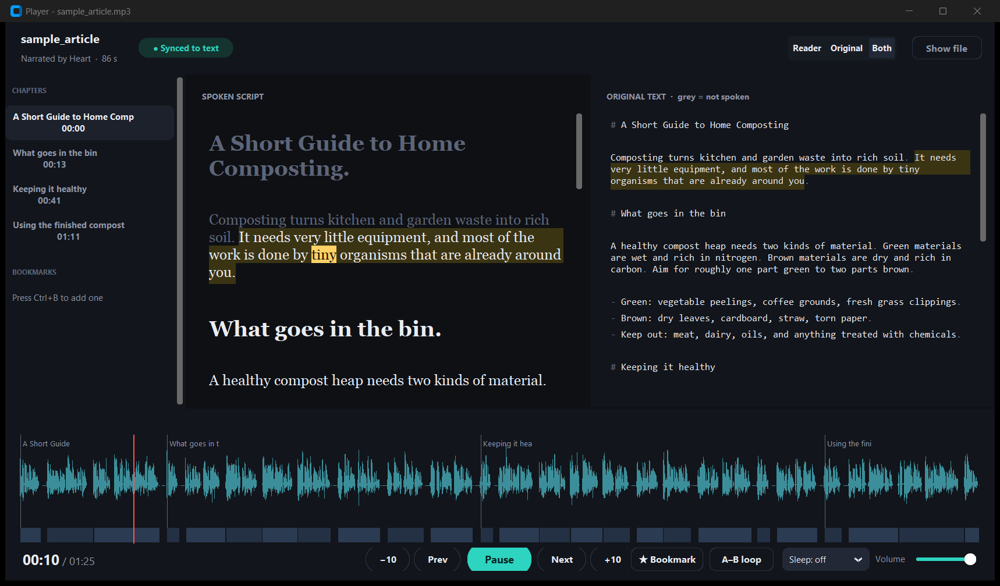
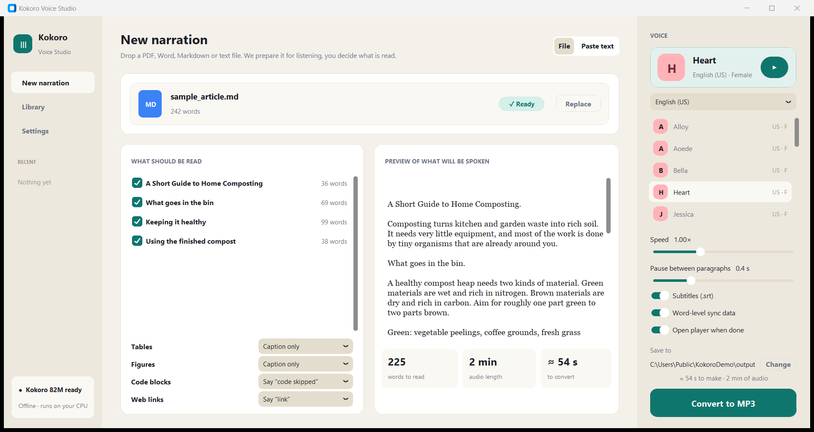
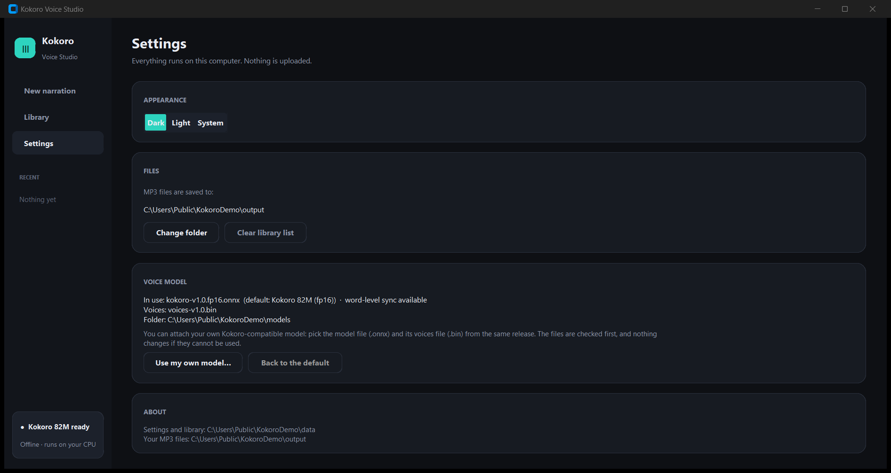

# 🎙️ Kokoro Voice Studio

### Your documents, read aloud by a surprisingly pleasant robot.
*Offline. Free. No subscription, no cloud, no "your trial has expired".*




---

## The pitch

You have a 120-page PDF. You have a commute, a dog that needs walking, or eyes that have been staring at screens
since the Obama administration. You do **not** have a spare week.

Kokoro Voice Studio turns that PDF (or Word file, Markdown, HTML, plain text, or whatever you just pasted) into a
proper **MP3**, using the open [Kokoro-82M](https://huggingface.co/hexgrad/Kokoro-82M) voice model. It runs on your
own computer, on your CPU, with no account and no internet (after one 190 MB model download). It's a real Windows
program, not a website wearing a trench coat.

## What it actually does

* 📄 **Reads real documents.** PDF, Word, Markdown, HTML, plain text, or pasted text. It skips the things nobody wants
  read aloud: page numbers, hyphen-broken lines, Markdown symbols, link addresses, and code.
  (A voice reciting `https://example.org/a8x7q?ref=…` is nobody's idea of a good time.)
* ✅ **You decide what gets spoken.** Chapters show up as checkboxes. Untick the bibliography, because no one has
  ever wanted to hear a bibliography. A live preview shows exactly what the voice will say.
* 🗣️ **54 voices in 9 languages**, with a preview button, plus speed and pause controls.
* 🎧 **A Player that follows along.** The sentence being spoken lights up, and so does the current *word*. Your original
  text sits beside it, with everything that wasn't spoken left grey, so nothing gets quietly lost. Chapters,
  waveform, A–B loop, sleep timer, bookmarks. It's a tiny audiobook app that you built yourself.
* 🎬 **Free subtitles.** Every MP3 comes with an `.srt` file and a `.json` timing file. Video editors, rejoice.
* 📊 **Live progress.** A ring, a time-left estimate, and the exact sentence being spoken right now.
  Cancel any time; the half-finished audio is kept, because we're not monsters.
* 🔌 **Bring your own model.** Swap in any Kokoro-compatible model from Settings. (More on that below.)
* 🌗 **Dark and light themes.** Dark is the default. Light mode is there for the brave.



Want to hear it before installing anything? Open `examples/sample_output/sample_article.mp3` in the Player
(*Library → Open audio file…*). Its `.json` and `.srt` files are right next to it. It's about composting. Riveting.

---

## Get started

### Option A: the Windows app (for people with better things to do)

1. If there is a `KokoroVoiceStudio-windows.zip` on this repository's **Releases** page, download and unzip it.
   If not, no problem: you can build it yourself with one command (see [Build it yourself](#build-it-yourself)).
2. Double-click `KokoroTTS.exe`.
3. The first time, it downloads the voice model (about 190 MB, once) and verifies it. Go get a coffee.
   After that, it never needs the internet again.

### Option B: run it from source (for people who read READMEs for fun)

Tested with Python 3.13 on Windows 11.

```powershell
git clone https://github.com/mann13072/kokoro-voice-studio.git
cd kokoro-voice-studio
pip install -r requirements.txt
python kokoro_app.py
```

The voice model downloads on first start. Prefer to fetch it up front? `python kokoro_app.py --download-models`.

---

## Using it (three steps; we counted)

1. **Add text.** Drop a file onto the window, click *Browse files*, or switch to *Paste text*.
2. **Choose.** Untick the chapters you don't want. Pick a voice. Decide how fast it should talk
   (1.0× is "calm narrator", 2.0× is "auctioneer on espresso").
3. **Convert to MP3.** The Player opens when it's done.

Your MP3, subtitles and timing file land in the `output/` folder (changeable in the window).
The app **never overwrites** an existing file: convert the same document twice and you get `name (2).mp3`,
not a tearful goodbye to the first one.



---

## Use your own model

Out of the box, the app uses the official Kokoro-82M fp16 model and downloads it for you. To use a different one:
**Settings → Voice model → Use my own model…**, then pick the model file (`.onnx`) and its voices file (`.bin`)
from the **same release**. They can live anywhere on your computer.



* The files are loaded and checked first. If they can't be used, you get a message and the working model stays in
  charge. Nothing explodes.
* Your choice is remembered. **Back to the default** undoes it.
* From the command line, add `--model path\to\model.onnx --voices path\to\voices.bin` to any command.

What we actually tested (Windows 11, `onnxruntime` 1.20.1), because "should work" is not a test result:

| Model | Result |
|---|---|
| Default `kokoro-v1.0.fp16.onnx` from release `model-files-v1.1` | Works, with word-level sync |
| `kokoro-v1.0.fp16.onnx` from the older `model-files-v1.0` release | Works, but it reports no timings, so the Player syncs per paragraph instead of per sentence |
| `kokoro-v1.0.int8.onnx` | **Does not run** with this ONNX Runtime ("ConvInteger not implemented"). The app politely refuses it and keeps the current model |
| A text file renamed to `.onnx` (we had to try) | Refused with a message |

The full-precision fp32 model and the Chinese `v1.1-zh` model were not tested.

---

## Where everything lives

The app creates and fills its own folders next to itself. There is nothing to set up, and nothing hiding in `AppData`.

```
kokoro-voice-studio/
├── kokoro_app.py          the whole app (or KokoroTTS.exe in the Windows build)
├── speak.py               tiny command-line example that doesn't use the window
├── models/                default voice model, downloaded on first run  (not in git)
├── data/                  settings.json, library.json, error.log        (not in git)
├── output/                your .mp3 / .srt / .json files                (not in git)
├── examples/              sample documents, and a ready-made sample narration to open in the Player
├── docs/                  FILE_FORMATS.md, ARCHITECTURE.md, VOICES.md, screenshots/
├── scripts/build_exe.ps1  builds the Windows app
├── tests/                 unit tests
├── assets/kokoro.ico      app icon
├── requirements.txt       libraries (tested versions)
├── LICENSE                GPL-3.0
└── THIRD_PARTY_NOTICES.md
```

If the folder is read-only (say, under *Program Files*), the app keeps these folders in
`%LOCALAPPDATA%\KokoroStudio\` instead. File formats are documented in [docs/FILE_FORMATS.md](docs/FILE_FORMATS.md),
the voice list in [docs/VOICES.md](docs/VOICES.md), and how it all works in [docs/ARCHITECTURE.md](docs/ARCHITECTURE.md).

## Command line (for people who think windows are a crutch)

```powershell
python kokoro_app.py --convert input.md output.mp3 --voice af_heart --speed 1.0
python kokoro_app.py --convert input.md out.mp3 --model my.onnx --voices my-voices.bin   # your own model
python kokoro_app.py --download-models
python kokoro_app.py --player output.mp3
python kokoro_app.py --prep paper.md paper_listen.md        # clean PDF-derived Markdown for listening
python speak.py "Hello, this is a test." --voice am_michael  # minimal WAV example
```

---

## The honest fine print

We would rather you hear these from us than discover them at 2 a.m.

* **PDF cleanup is tuned for papers and theses.** It looks for an *Abstract*, a *Contents* list, `Chapter N.` headings
  and *References*, keeps the abstract and chapters, and leaves out the rest. Documents without that structure are
  read whole, with page numbers and hyphenation still cleaned up. A PDF that is just a scan of pictures has no text
  to read, and there is no OCR. The voice can't read what the PDF doesn't contain.
* **Figures are not described.** Only their captions are spoken. The pie chart remains a mystery.
* **Speed.** On the author's computer (CPU only), conversion runs about 1.9× faster than real time, so a two-hour
  recording takes about an hour. The window shows an estimate before you commit.
* **Word-level highlighting** is used where the spoken words match the written words one-to-one. A sentence with a
  number like "3,450" (which is spoken as several words) is highlighted as a whole sentence instead.
  Timings are never guessed.
* **Languages.** English is Kokoro's strongest. The voice you pick decides the language; mixed-language text is not
  detected.
* **Platform.** Built and tested on Windows 11. macOS and Linux are untested, so no promises, only vibes.

## Troubleshooting

| Problem | What to do |
|---|---|
| *Voice model not ready* in the sidebar | You're offline or the download was interrupted. Click *Try again*, or download the two files by hand into `models/` (see [models/README.md](models/README.md)). |
| Windows SmartScreen or antivirus frowns at the `.exe` | The app isn't code-signed, which is common for programs made with PyInstaller. Run it from source (Option B) if you'd rather not trust a stranger's binary. Honestly, fair. |
| No sound in the Player | Check that a playback device is selected in Windows. The Player still shows the text without one. |
| Drag and drop does nothing | Use *Browse files*. Windows blocks dropping onto a window that runs as administrator. |
| Anything else | Look at `data/error.log`. |

## FAQ

**Is it really offline?** Yes. The only network request is the one-time model download. Your documents never leave
your computer.

**Why is the default voice called "Heart"?** Kokoro (心) is Japanese for "heart" or "spirit". We noticed too.

**Will it read my code aloud?** No. It says "code block skipped" and moves on, or says nothing if you prefer.
Your colleagues will be spared "open parenthesis, open parenthesis, self dot…".

**Can I use the audio commercially?** Check the licences of the model and voices you use. See
[THIRD_PARTY_NOTICES.md](THIRD_PARTY_NOTICES.md). We are not lawyers, and neither is the robot.

**Why is it one giant Python file?** Because the goal was a single native `.exe` that's easy to read and build.
The sections are labelled if you'd like to split it.

---

## Build it yourself

```powershell
pip install -r requirements-dev.txt
.\scripts\build_exe.ps1 -Zip
```

That produces `dist\KokoroTTS\KokoroTTS.exe` and a zip of the folder (about 150 MB, and about 70 MB zipped).
The voice model is not bundled; the app downloads it on first run. Run the tests with
`python -m unittest discover -s tests -v` (21 of them, no model needed, a few seconds).

## Contributing

Bug reports, ideas and pull requests are welcome. Please run the tests first. If you're fixing a text-cleaning
problem, a tiny example file that shows it is worth a thousand words.

## Privacy

Documents never leave your computer. We don't know what you read, and we're strong enough to resist the temptation to
guess.

## Licence and credits

Released under the **GNU General Public License v3.0** (see [LICENSE](LICENSE)), because it builds on GPL-licensed
speech components. The Kokoro model is Apache-2.0. The full list is in [THIRD_PARTY_NOTICES.md](THIRD_PARTY_NOTICES.md).

Huge thanks to [hexgrad](https://huggingface.co/hexgrad/Kokoro-82M) for Kokoro-82M,
[thewh1teagle](https://github.com/thewh1teagle/kokoro-onnx) for kokoro-onnx, and the authors of eSpeak NG,
CustomTkinter, pdfminer.six and every other library in the notices. This project is mostly glue; they did the
hard parts.
